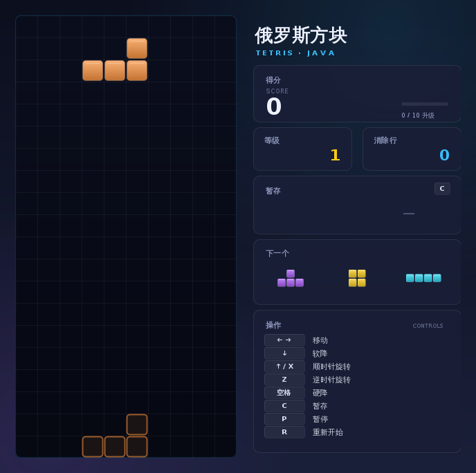
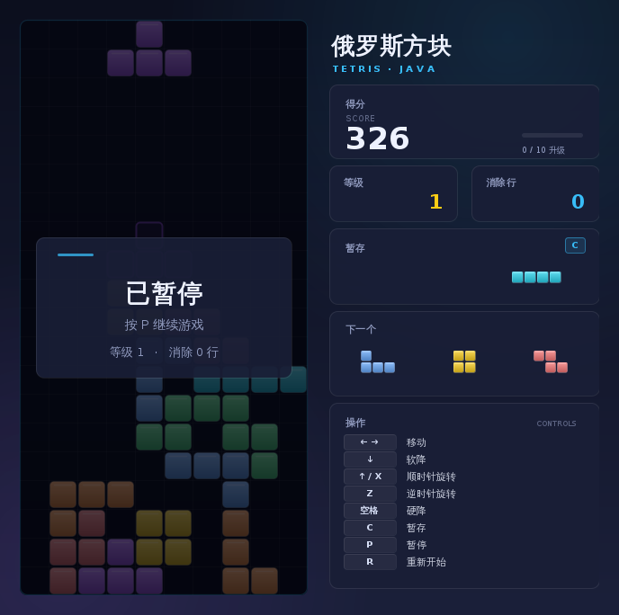
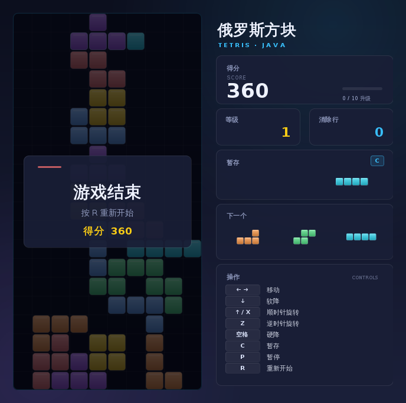

# 俄罗斯方块 · Java

一个使用 **Java 17 + Swing** 实现的俄罗斯方块游戏，不依赖任何第三方运行时库。规则逻辑与界面完全分离：`GameEngine` 可以在没有窗口的情况下被测试和驱动。


## 功能

- 标准 10 × 20 棋盘与 7 种方块
- 遵循 Super Rotation System（SRS）的旋转与踢墙
- 7-bag 随机发块，避免同一种方块长时间不出现
- 幽灵方块（落点预览）、下一个方块预览与暂存（Hold）
- 分数、等级、消除行数统计，每 10 行升级，等级越高下落越快
- 500 ms 锁定延迟，落地后仍可微调；最多 15 次移动重置
- 消行提示（含 TETRIS!）、暂停与游戏结束遮罩
- 中文界面与键盘操作

## 运行

需要 JDK 17 或更高版本。

```bash
cd tetris
./run.sh
```

`run.sh` 在检测到 Maven 时会直接打包运行；否则会使用 `javac` 编译到 `build/classes` 后运行。

也可以手动使用 Maven：

```bash
cd tetris
mvn package
java -jar target/tetris.jar
```

可选参数 `--seed <数字>` 可复现固定的方块序列，便于调试：

```bash
java -jar target/tetris.jar --seed 42
```

## 操作

| 按键 | 功能 |
| --- | --- |
| ← / →（或 A / D） | 左右移动 |
| ↓（或 S） | 软降（每格 +1 分） |
| ↑ / X / W | 顺时针旋转 |
| Z | 逆时针旋转 |
| 空格 | 硬降（每格 +2 分） |
| C | 暂存 / 交换方块 |
| P / Esc | 暂停 / 继续 |
| R | 重新开始 |

## 计分

| 一次消除 | 得分 |
| --- | --- |
| 1 行 | 100 × 等级 |
| 2 行 | 300 × 等级 |
| 3 行 | 500 × 等级 |
| 4 行（Tetris） | 800 × 等级 |

每消除 10 行升一级，下落间隔从 800 ms 逐级缩短，最快 80 ms。

## 构建与测试

```bash
cd tetris
mvn test        # 运行 JUnit 5 单元测试（规则、渲染冒烟测试）
mvn package     # 生成 target/tetris.jar
```

## 截图

| 开始 | 暂停 | 游戏结束 |
| --- | --- | --- |
|  |  |  |

截图由 `src/test/java/tetris/tools/UiScreenshotter.java` 在 Xvfb 下驱动真实窗口生成，固定随机种子为 `20261114`。

## 项目结构

```
tetris/
├── pom.xml
├── run.sh
├── src/main/java/tetris/
│   ├── Main.java              # 程序入口
│   ├── game/                  # 与界面无关的游戏规则
│   │   ├── Board.java         # 棋盘、碰撞与消行
│   │   ├── Tetromino.java     # 7 种方块及 SRS 旋转/踢墙表
│   │   ├── Piece.java         # 方块实例
│   │   ├── BagRandomizer.java # 7-bag 随机
│   │   └── GameEngine.java    # 重力、锁定、计分、等级、暂存
│   └── ui/                    # Swing 界面
│       ├── Theme.java         # 配色、字体与绘制工具
│       ├── BoardPanel.java    # 棋盘、幽灵方块、遮罩
│       ├── SidePanel.java     # 分数、预览、操作说明
│       └── GameFrame.java     # 窗口、计时器与按键绑定
├── src/test/java/tetris/      # JUnit 5 测试与截图工具
└── docs/screenshots/          # 界面截图
```

## 实现说明

- **碰撞与消行**：棋盘用二维数组保存已锁定方块；消行时自底向上压缩，保留非满行。
- **SRS**：`Tetromino` 保存 4 个旋转状态和标准踢墙偏移（已换算为屏幕坐标，y 向下为正）。
- **锁定延迟**：落地后 500 ms 才锁定，期间成功移动/旋转会重置计时，最多重置 15 次。
- **随机**：每袋包含全部 7 种方块各一次并打乱，`GameEngine` 维护 5 个待发方块队列，并始终向界面提供 3 个预览。
- **渲染**：界面使用 Java2D 自绘，棋盘、方块、卡片和遮罩均由 `Theme` 统一绘制。

## 许可证

与仓库根目录一致，使用 MIT 许可证。
