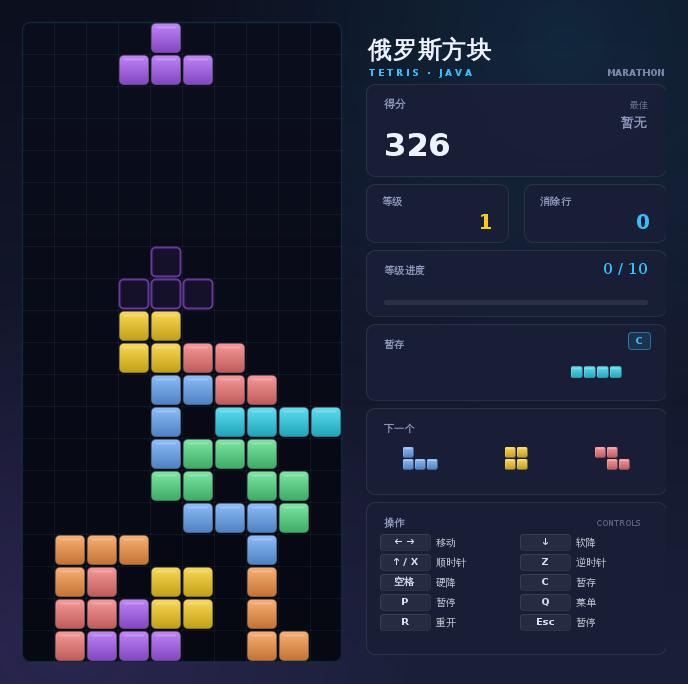

# 俄罗斯方块 · Java

一个使用 **Java 17 + Swing** 实现的俄罗斯方块游戏，不依赖任何第三方运行时库。规则逻辑与界面完全分离：`GameEngine` 可以在没有窗口的情况下被测试和驱动。


## 功能

- 三种模式：**马拉松**（无尽）、**冲刺 40 行**（竞速）、**极速 2 分钟**（限时得分）
- 标准 10 × 20 棋盘与 7 种方块，遵循 SRS 旋转与踢墙
- 7-bag 随机发块，幽灵方块、三格预览与暂存（Hold）
- 连击（Combo）与连续 Tetris（B2B）加成
- 每局结算：等级、消除行、Tetris 次数、最大连击、方块数、PPS
- 各模式个人最佳记录，自动保存在本机并在菜单/结算页展示
- 暂停菜单：继续、重开、返回主菜单
- 500 ms 锁定延迟，落地后仍可微调
- 中文界面与键盘操作

## 运行

需要 JDK 17 或更高版本。

```bash
cd tetris
./run.sh
```

`run.sh` 在检测到 Maven 时会直接打包运行；否则会使用 `javac` 编译到 `build/classes` 后运行。

也可以手动使用 Maven：

```bash
cd tetris
mvn package
java -jar target/tetris.jar
```

可选参数 `--seed <数字>` 可复现固定的方块序列，便于调试：

```bash
java -jar target/tetris.jar --seed 42
```

## 模式

| 模式 | 结束条件 | 个人最佳 |
| --- | --- | --- |
| 马拉松 MARATHON | 方块堆到顶部 | 最高分 |
| 冲刺 40 行 SPRINT | 清空 40 行，或提前堆满 | 完成 40 行的最快时间 |
| 极速 2 分钟 ULTRA | 120 秒倒计时结束，或提前堆满 | 最高分 |

主菜单用 ↑ / ↓ 选择，Enter / Space 开始，1 / 2 / 3 直接开始对应模式。

## 操作

| 按键 | 功能 |
| --- | --- |
| ← / →（或 A / D） | 左右移动 |
| ↓（或 S） | 软降（每格 +1 分） |
| ↑ / X / W | 顺时针旋转 |
| Z | 逆时针旋转 |
| 空格 | 硬降（每格 +2 分） |
| C | 暂存 / 交换方块 |
| P / Esc | 暂停 / 继续 |
| R | 重新开始当前模式（菜单中为开始当前选择） |
| Q | 暂停或结算时返回主菜单 |

暂停后可继续、重开或返回菜单；结算页按 R 再来一局，按 Enter / Q 返回菜单。

## 计分

| 一次消除 | 基础得分 |
| --- | --- |
| 1 行 | 100 × 等级 |
| 2 行 | 300 × 等级 |
| 3 行 | 500 × 等级 |
| 4 行（Tetris） | 800 × 等级 |

- **连击**：连续两次及以上落地消行时，额外 `50 × (连击数 - 1) × 等级` 分。
- **B2B**：连续两次 Tetris，后一次基础分 × 1.5。
- 每消除 10 行升一级，下落间隔从 800 ms 逐级缩短，最快 80 ms。

## 个人最佳

记录保存在用户目录下的 `.tetris-java/highscores.properties`。如果目录不可写，游戏仍可正常游玩，只是不会持久化记录。冲刺模式只有真正完成 40 行才会记录时间，提前堆满不会占用记录。

## 构建与测试

```bash
cd tetris
mvn test        # 运行 JUnit 5 单元测试
mvn package     # 生成 target/tetris.jar
```

## 截图

| 游戏进行中 | 暂停 |
| --- | --- |
|  |  |

| 结算 |
| --- |
|  |

截图由 `src/test/java/tetris/tools/UiScreenshotter.java` 在 Xvfb 下驱动真实窗口生成，固定随机种子为 `20261114`。

## 项目结构

```
tetris/
├── pom.xml
├── run.sh
├── src/main/java/tetris/
│   ├── Main.java              # 程序入口
│   ├── game/                  # 与界面无关的游戏规则
│   │   ├── Board.java         # 棋盘、碰撞与消行
│   │   ├── Tetromino.java     # 7 种方块及 SRS 旋转/踢墙表
│   │   ├── Piece.java         # 方块实例
│   │   ├── BagRandomizer.java # 7-bag 随机
│   │   ├── GameMode.java      # 三种模式及结束条件
│   │   ├── GameEngine.java    # 重力、锁定、模式计时、计分、等级、暂存
│   │   ├── GameResult.java    # 单局结果快照
│   │   └── HighScoreStore.java# 本机个人最佳记录
│   └── ui/                    # Swing 界面
│       ├── Theme.java         # 配色、字体与绘制工具
│       ├── MenuPanel.java     # 模式选择主菜单
│       ├── BoardPanel.java    # 棋盘、幽灵方块、暂停遮罩
│       ├── SidePanel.java     # 分数、模式进度、预览、操作说明
│       ├── SummaryPanel.java  # 单局结算
│       └── GameFrame.java     # 窗口、计时器与按键绑定
├── src/test/java/tetris/      # JUnit 5 测试与截图工具
└── docs/screenshots/          # 界面截图
```

## 实现说明

- **模式**：`GameMode` 描述目标行数与时间上限；`GameEngine` 在 `update` 中推进倒计时，在目标达成或时间耗尽时进入 `FINISHED` 状态。
- **连击 / B2B**：`ClearResult` 携带单次消行的行数、总得分、连击数与 B2B 标记，界面据此显示 `COMBO ×N` / `B2B` 提示。
- **记录**：`HighScoreStore` 使用 Properties 文件持久化，采用临时文件 + 原子移动写入；读写失败时静默降级。
- **界面**：`GameFrame` 用 `CardLayout` 在菜单、游戏、结算三个页面之间切换；游戏页仍是自绘棋盘 + 信息栏。
- **渲染**：棋盘、方块、卡片和遮罩均由 `Theme` 统一绘制。

## 后续可扩展的功能建议

- 音效与背景音乐（可开关、可调音量）
- T-spin 识别与专属计分
- 双人对战、垃圾行与 AI 对手
- 键位自定义、手柄支持
- 主题皮肤与方块材质切换
- 回放导出、每日挑战与在线排行榜
- 成就系统与任务

## 许可证

与仓库根目录一致，使用 MIT 许可证。
